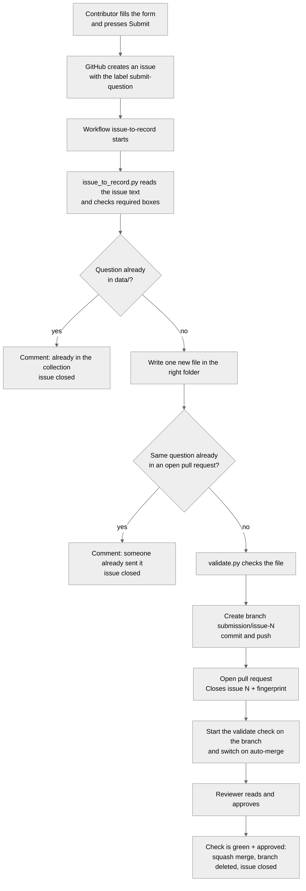

# How everything works

This guide is for the project founder. It explains what has been built, how each part fits together, and in particular how a form filled in by a contributor becomes a pull request and then part of the dataset. Read it once from top to bottom, and keep it for the day something does not behave as expected.

## 1. What we built, in one paragraph

Cameroon Open Data is a Git repository that stores Cameroonian knowledge as small text files. Contributors never have to write those files. They fill in a web form, and a robot (a GitHub Action) writes the file for them, checks it, and asks a human reviewer to approve it. The first sector filled is education, starting with the GCE Ordinary Level, because exam questions are the clearest and most useful kind of data to begin with.

## 2. The parts of the repository

| Part | What it is for |
|---|---|
| `README.md` | The story and invitation for the public. |
| `data/` | The collection itself. 15 sectors, about 140 folders, each with a short guide. Ordinary Level has one folder per subject. |
| `schema/` | The rules that every record must follow (required fields, allowed values). |
| `tools/validate.py` | The checker. It reads every data file, applies the schema, and refuses exact duplicates. |
| `tools/common.py` | Shared helpers: it builds a record from form answers, chooses the folder and file name, and computes the question fingerprint. |
| `tools/issue_to_record.py` | Reads a submitted issue and writes one new record file. |
| `tools/csv_to_jsonl.py` | Does the same for spreadsheets. |
| `tools/build_structure.py` | Recreates the folder tree and guides when you add a new category. |
| `.github/ISSUE_TEMPLATE/` | The forms people see under New issue. |
| `.github/workflows/` | The robots: `issue-to-record.yml` (form to pull request) and `validate.yml` (the check). |
| `docs/` | Guides for contributors, maintainers and developers, and format examples. |
| `templates/` | The spreadsheet template for people with many questions. |

## 3. What a record looks like

Each question is one line of JSON stored in its own file, for example `physics-section-i-q5-4bfb20.jsonl`. The line has four parts: an `id`, a `type` (here `exam_question`), a `meta` block saying who contributed it, in which language, from which source and with which rights status, and a `content` block with the exam, subject, year, question text, marks and a description of any diagram. The file name ends with a short fingerprint of the question text, which makes every question's file name unique.

## 4. How a form becomes a pull request

In words, step by step:

1. **The form.** The contributor chooses "Submit an exam question" in the Issues tab. The form file in `.github/ISSUE_TEMPLATE/` defines every box. GitHub turns the answers into an issue whose text has a `### Box name` heading followed by the answer for each box. The form automatically adds the label `submit-question`.
2. **The trigger.** `issue-to-record.yml` listens for newly opened issues. It runs only when the issue text contains the `### Agreement` heading, which only the submission forms produce, so ordinary issues, photo forms and claims are ignored. It does not depend on labels, so a missing label cannot stop it.
3. **Reading the issue.** `issue_to_record.py` works out which form was used from its headings (for example "The question" means the exam form, "The text" means the text form), splits the issue text at each `###` heading and matches the headings to field names. It stops with a friendly message if the exam, subject or question is empty, or if the agreement box is not ticked.
4. **Building the record.** `common.build_record` turns the answers into a record. Dropdown choices are translated into schema values, for example "I am not sure" becomes `unclear_needs_review`. It computes the fingerprint (subject plus question text, ignoring capitals, accents, spaces and punctuation), picks the folder from the exam and subject, and creates a unique file name.
5. **Duplicate check one.** If the fingerprint already exists anywhere in `data/`, the script stops and the workflow comments "already in the collection" and closes the issue.
6. **Duplicate check two.** The workflow searches open pull requests for the same fingerprint, which is stored at the bottom of every pull request description. If one exists, the contributor is told and the issue is closed.
7. **Validation.** `validate.py` checks the new file against the schemas.
8. **Branch and pull request.** The workflow creates a branch named `submission/issue-N`, commits the new file, pushes, and opens a pull request whose description says "Closes #N" and includes the fingerprint. "Closes #N" makes GitHub close the issue automatically when the pull request merges.
9. **The check.** GitHub does not start normal checks for pull requests opened by a workflow's built-in token. So the workflow starts `validate.yml` itself on the new branch, which makes the required `validate` check appear on the pull request.
10. **Auto-merge.** The workflow switches on auto-merge. Once a reviewer approves and the check is green, GitHub squash-merges the pull request and deletes the branch.
11. **The comment.** The contributor gets a comment on their issue saying the question was sent for review.

If anything fails, the last step of the workflow comments on the issue with what to fix. The full run log is in the repository's Actions tab.

## 5. Why contributors cannot conflict

Every submission is a new file with its own name, so two pull requests never change the same file. Git only complains when two branches edit the same lines, and here that can never happen. The contributor's name lives inside the record, not in a shared list, and nothing in the repository gets edited by hand every time someone contributes.

## 5b. The forms, and how to add or change them

| Form | What it collects | Record type |
|---|---|---|
| Submit an exam question | Questions from GCE, Francophone, primary and concours examinations | `exam_question` |
| Submit a text | Proverbs, stories, speeches, laws, recipes, articles, descriptions, oral histories | `text_document` |
| Submit a question and its answer | Local knowledge as questions with checkable answers, in any sector | `qa_pair` |
| Submit a translation | The same sentence in two languages, including Pidgin and national languages | `parallel_text` |
| Submit facts about a place, institution, law, crop or event | One named thing with details written as `label: value` lines | `structured_record` |
| Share a recording, scan or document | Audio, video or scans for a volunteer to transcribe | none yet |
| Share photos of a paper, Send a spreadsheet, Claim a paper | Helpers for exam material | none |

Every form except the exam form shares the same closing boxes: language, region, how the contributor knows it, where it comes from, the right to share it, whether it needs special care, the contributor's name, and the agreement. The folder box lists every folder, so any kind of record can go in any sector.

The forms are generated from one description in `tools/forms_spec.py`. To add a folder, add it to `tools/build_structure.py`, then run `python tools/build_structure.py` and `python tools/build_forms.py`, and commit the changes. To change a form box, edit `tools/forms_spec.py` and run `python tools/build_forms.py`. Never edit the generated form files by hand, because the next run overwrites them.

Languages: the contributor picks English, French, Pidgin or Camfranglais, or types the name of another language. Known Cameroonian languages are matched to their codes automatically. A language the system does not know is stored as `und` with the name in `language_note`, so nothing is rejected and a reviewer can fix the code later.

## 6. Other ways to contribute

**Photos.** The photo form creates an issue labelled `needs-transcription`. No robot runs. A volunteer types the questions through the question form.

**Spreadsheet.** The spreadsheet form creates an issue labelled `needs-conversion`. A maintainer downloads the CSV, runs `python tools/csv_to_jsonl.py file.csv` and `python tools/validate.py`, and opens one pull request. Each row becomes its own file and duplicates are skipped.

**Claiming a paper.** The claim form creates an issue labelled `claimed`, so two volunteers do not transcribe the same paper.

**Developers.** They can add `.jsonl` files directly through pull requests, following `docs/FORMAT_GUIDE.md`.

## 7. Your checklist

Already done: the repository is on GitHub, the update branch is pushed, and your default branch is `master`.

Still to confirm, in this order:

1. Merge the update pull request, then `git pull`.
2. Replace the two files in `.github/workflows/` with the fixed versions, then commit and push.
3. Confirm the labels exist: `gh label list -R iws3/cameroon-open-data`.
4. Settings, Actions, General: allow Actions to create and approve pull requests.
5. Settings, General, Pull Requests: allow squash merging and auto-merge, and delete head branches automatically.
6. Test with one real question and watch the Actions tab.
7. After the test works, add branch protection on `master`: require a pull request, one approval, and the `validate` check. The `validate` check only appears in the list after it has run once.
8. Decide whether the repository stays public, and match `ACCESS.md` to your decision.

## 8. When something goes wrong

**The form creates an issue but nothing happens.** Open the Actions tab. If there is no run at all, the workflow file is not on `master`. If the run is grey and says skipped, the issue did not contain the `### Agreement` heading, which means it was not created from a submission form. If there is a failed run, open it and read the red step.

**The workflow fails at "open a pull request".** Actions are not allowed to create pull requests. Switch on the setting in step 4.

**The pull request never merges by itself.** Auto-merge needs branch protection with at least one required check. Until you add it, merge by hand.

**The `validate` check says "Expected, waiting".** The fixed workflow starts it by hand. If it still hangs, open the Actions tab and run "Validate data" manually on the branch.

**A contributor cannot see the form.** The form files must be on `master`, and the contributor must be signed in to GitHub.

**A label does not exist.** Create it under Issues, Labels.

## 9. Your daily routine as a maintainer

Open the Pull requests tab, read each new question against the original, check the marks and the diagram description, then approve. Close stale claims after three weeks. Answer questions in the Issues tab. Run `python tools/validate.py` after pulling, to be sure the whole collection is still healthy.

## 10. What to be honest about

The form-to-pull-request pipeline was tested here only in its Python parts. The GitHub side runs for the first time on your repository, so expect to fix a small thing or two during your first test. GitHub cannot verify that someone is Cameroonian, so `ACCESS.md` describes a trust-based process, and that process only truly applies to a private repository. In a public repository, issues and pull requests are visible to everyone, including papers marked "rights unclear". Rights over official past papers belong to the examination bodies, so you should clarify with them before the data is released widely.
